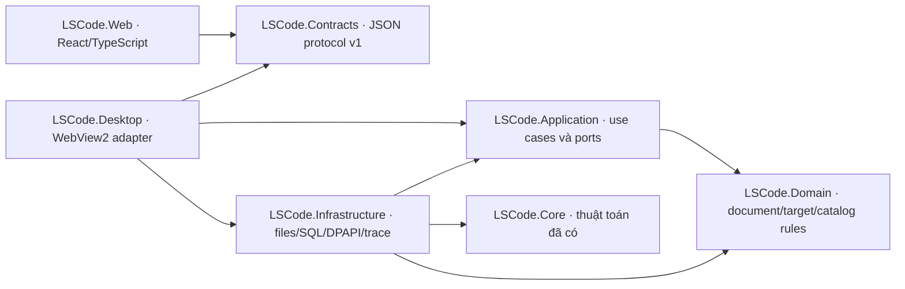

> Bản mới nằm tại `artifacts/publish-webview-tab-stripes/LSCode.WebView.exe`. [Lịch sử file và thao tác dự án](WORKBENCH-PROJECT-HISTORY.vi.md)

> Cập nhật mới: [Workbench 10/11/2026](WEBVIEW-UPDATE-2026-11-10.vi.md), thay thế mô tả explorer, split editor, startup và Profiler cũ.

# LSCode React + WebView2 — hướng dẫn và trạng thái chuyển đổi

Ngày 10/11/2026. Stack được chọn: React 18, TypeScript, Monaco Editor, WPF host tối thiểu, WebView2 và .NET 10.

## Chạy bản đã đóng gói

Mở `artifacts/publish-webview/LSCode.WebView.exe`. Giữ nguyên toàn bộ thư mục đi kèm, đặc biệt `wwwroot`, `Assets`, `Template`, DLL và `LSCode.TraceHost.exe`; không chỉ sao chép một file EXE. Máy chạy cần .NET 10 Desktop Runtime và Microsoft Edge WebView2 Runtime.

### Khởi động và thao tác trong trình soạn thảo

- Màn chờ xanh hiện từ cửa sổ Windows trước khi WebView2 khởi tạo. Màn chờ đóng khi giao diện đã vẽ xong màn chọn dự án. Nếu WebView2 lỗi hoặc quá 45 giây, app hiển thị lỗi để người dùng có thể đóng và mở lại. Tailwind v4 điều khiển chuyển động của màn chờ web và thanh tải, không bật Preflight. Tùy chọn giảm chuyển động được áp dụng cho các hiệu ứng tải.
- Trong **Chức năng ERP**, chọn một mục để xem các file liên quan của controller theo cây thư mục vật lý trong tab **File**. Chọn file để mở editor. Chọn file hoặc thư mục và nhấn **F2** để đổi tên.
- Trong **Dự án của bạn**, bấm **Đồng bộ dự án** để thêm dự án khác. Đường dẫn chương trình mặc định là `http://172.168.5.14/<tên dự án>/Main/Login.aspx`. App mã hóa tên dự án trong URL và giữ đường dẫn đã chỉnh khi đồng bộ lại cùng hồ sơ.
- Trong tab **DB**, gõ tên object để tìm. App đợi 280 ms sau lần gõ cuối, hoặc 500 ms khi bật **Tìm nội dung**, hủy yêu cầu cũ và giữ kết quả trước trong lúc chờ. Kết quả phân trang 200 dòng bằng `ROW_NUMBER()` và `TOP`, tương thích SQL Server không hỗ trợ `OFFSET … FETCH`. Bộ nhớ đệm tối đa 24 trang trong 30 giây. Nút **Tìm**, Enter và **Tải lại** truy vấn trực tiếp.
- Bấm **Ẩn không gian dự án** ở đầu sidebar. Bấm biểu tượng **File dự án**, **Chức năng ERP** hoặc **Database** ở thanh dọc để hiện lại vùng tương ứng.
- Kéo mép trên của panel kết quả để đổi chiều cao. Có thể Tab đến mép này rồi dùng mũi tên lên/xuống, Shift để tăng bước, hoặc Home/End để chọn chiều cao nhỏ nhất/lớn nhất.
- **SQL Profiler** mở thành tab cạnh các file. Tên đăng nhập mặc định là `profile`. Khi nhận sự kiện, lưới cuộn xuống cuối và hiện SQL của sự kiện mới nhất. Chọn hoặc cuộn đến dòng cũ sẽ tạm ngưng tự cuộn trong khi phiên thu tiếp tục. Bấm **Theo dõi cuối lưới** để theo tiếp. Kéo qua các ô rồi nhấn **Ctrl+C** để dán vùng vào Excel. Đổi tab giữ phiên thu, đóng tab sẽ dừng phiên.
- Nhấn `Ctrl+Shift+T` để mở một tab **Cấu trúc và dữ liệu** cạnh đường dẫn file. Mỗi tab dùng kết nối của editor lúc mở và giữ riêng bảng, bộ lọc, kết quả. Tên bảng xuất hiện trên tab sau khi đọc. Nhập tên bảng để dùng schema `dbo`, hoặc nhập `schema.bảng` cho schema khác. Ô bảng và các ô **Cột SELECT**, **WHERE**, **ORDER BY** có gợi ý từ metadata SQL.
- Chế độ **Cấu trúc** hiển thị khóa chính, khóa ngoại và ràng buộc duy nhất. Chọn các dòng rồi nhấn chuột phải. **Gen ADD COLUMN** và **Gen ALTER COLUMN** sao chép script theo định nghĩa hiện tại của cột để bạn dán vào tab SQL, chỉnh và chạy. **DROP COLUMN** chạy lệnh trên kết nối hiện tại sau khi xác nhận. SQL Server sẽ từ chối nếu cột còn phụ thuộc vào khóa hoặc ràng buộc.
- Để tạo script phân kỳ ERP, mở bảng trên kết nối **App**. Nếu tên gốc khớp `dbo.sysgendata.basetable`, chẳng hạn `d46`, `d46$` hoặc `d46$000000`, script tác động tới bảng mẫu, bảng `$log` nếu có và gọi `FastBusiness$Partition$Execute` cho các bảng `$%Partition`. Khoảng chạy lấy từ ngày nhỏ nhất trong `dmstt.ngay_gh1` đến ngày lớn nhất trong `dmstt.ngay_gh2`. Với **ADD**, script bỏ qua các cột đã có và cập nhật `NULL` thành chuỗi rỗng cho cột kiểu ký tự cho phép `NULL`. Với **ALTER**, script đổi kiểu và khả năng nhận `NULL` của cột hiện có.
- Menu **Script** có **Script tạo bảng** và **Script INSERT dữ liệu đang hiển thị**. Script INSERT lấy đúng tập dòng đã đọc, tối đa 1.000 dòng, và bỏ các cột do SQL Server tự sinh như computed hoặc rowversion. Cả hai mở trong tab SQL để xem hoặc sao chép.

Styles do dự án quản lý được build qua Tailwind v4. `motion.css` là điểm vào của utility và token animation. `styles.css` dùng `@apply` để giữ nguyên thứ tự selector của các component hiện có. Token theme, keyframe và các khai báo dành riêng cho WebView2 vẫn viết ở dạng CSS gốc. Preflight được tắt để tránh làm đổi bố cục Monaco và các control hiện có.

### Kiểm tra và đóng gói

Chạy `./build-webview.ps1 -Test -Smoke -Publish` để tạo bản chạy trực tiếp. Bài kiểm tra SQL có thể dùng SQL Server LocalDB thông qua `LSCODE_TEST_SQL_SERVER`.

Khi bản trước đang mở, dùng `-PublishDirectory artifacts/publish-webview-profiler` để xuất bản cạnh bản đang chạy.

```powershell
$env:LSCODE_TEST_SQL_SERVER = '(localdb)\MSSQLLocalDB'
dotnet run --project tests/LSCode.WebView.Tests -c Release -- --sql
```

Để tạo bộ cài Windows x64, sau khi build frontend, publish self-contained vào thư mục mới. Chạy Inno Setup với `scripts/LSCode.WebView.iss` và `/DPublishDir=<thư mục publish>`. Đặt bộ khởi động WebView2 của Microsoft ở `artifacts/installer-tools/MicrosoftEdgeWebview2Setup.exe` trước khi biên dịch bộ cài. Kết quả nằm tại `artifacts/installer/LSCode-WebView-Setup-x64.exe`.

1. Chọn dự án trong thanh ngữ cảnh, hoặc mở thư mục/file để làm việc độc lập.
2. Với dự án đã đồng bộ, mở tab SQL sẽ có các target App/SYS do .NET đọc từ cấu hình. Target được giữ riêng cho từng tab.
3. Với profile chưa có connection strings, dùng **Kết nối SQL** để chọn server/database và Windows/SQL authentication.
4. F5 chạy selection nếu có, nếu không chạy cả document. Nút Dừng hủy SqlCommand. Kết quả có nhiều result sets và xuất CSV.
5. Ctrl+Shift+P tìm mọi công cụ: danh mục, XML/XPath/include, snippets, compare, Profiler, dịch, Crystal và cài đặt.

Trình duyệt tại `http://127.0.0.1:4173` chỉ dùng xem/kiểm tra giao diện. Không có HTTP backend hoặc kết nối SQL trong bản xem này. Mở EXE để dùng chức năng thật.

## Build và kiểm chứng

```powershell
# Frontend + .NET + kiểm tra nền + smoke WebView2 thật + publish
./build-webview.ps1 -Test -Smoke -Publish

# Thêm tích hợp SQL trên instance cục bộ . bằng Windows Authentication
./build-webview.ps1 -Test -SqlIntegration -Smoke -Publish

# Build cả solution, gồm bản WPF cũ
dotnet build LSCode.sln -c Release -m:1 -p:UseSharedCompilation=false

# Chạy riêng SQL/Profiler integration
dotnet run --project tests/LSCode.WebView.Tests/LSCode.WebView.Tests.csproj -c Release -- --sql --profiler
```

SQL integration chỉ tạo database tên ngẫu nhiên `LSCodeWebViewTest_<GUID>` trên **instance cục bộ `.`**, sau đó xóa đúng database do chính phép thử tạo. Không chạy phép thử ghi trên database khách hàng. Lựa chọn `--profiler` dùng Extended Events; thêm `--profiler-ssms18` nếu muốn kiểm tra nhánh SSMS 18 trên server tương thích.

Để chạy kiểm tra tương tác UI bằng fixture transport:

```powershell
# Chạy server preview, để tiến trình này chạy trong terminal riêng
node scripts/preview-webview.mjs

# Playwright cài riêng trong thư mục công cụ, không cần thêm vào dependencies của app
node scripts/test-webview-ui.mjs <thư-mục-có-node_modules-playwright>
```

Script kiểm tra UI dùng fake native transport được khai báo rõ trong chính script. Kết quả này kiểm chứng hành vi React/Monaco, không thay thế SQL/.NET integration.

## Kiến trúc hiện có



- **Domain** không tham chiếu WPF, WebView2, SQLClient hay filesystem.
- **Application** điều phối mở/lưu/khôi phục, chọn file/thư mục và ranh giới thực thi lệnh; phụ thuộc port, không phụ thuộc Infrastructure.
- **Infrastructure** thực hiện lưu file, snapshot/hash, search/index, catalog DPAPI, kết nối/query/schema, dịch, snippets, designer transaction và hai engine Profiler. Các thuật toán thuần đang có trong Core được tái sử dụng qua adapter, không đưa toàn bộ Core chứa IO vào Domain.
- **Desktop** là composition root và adapter Windows: WebView2, native file picker, clipboard trên STA thread, mở cửa sổ mới và đóng ứng dụng. Nội dung web chỉ tải từ asset đóng gói tại origin cố định `https://lscode.local`; navigation/frame/window lạ và quyền trình duyệt được chặn.
- **Web** gồm workbench, Monaco model registry, gateway và các màn riêng trong `src/LSCode.Web/src/features`. Connection strings/session secret giữ phía .NET; mật khẩu chỉ nằm tạm trong form và được xóa sau kết nối, không ghi localStorage/settings. Một Monaco model dùng chung cho split panes; kết quả và target gắn với tab. Caret/scroll/selection được giữ theo file và pane; đóng pane không xóa target completion. Response tìm kiếm/metadata cũ bị loại khi ngữ cảnh thay đổi.

Một số adapter thuần .NET vẫn dùng `Compile Link` tới file dịch vụ gốc ở `LSCode.Shell/Services`. Đây là tái sử dụng source có chủ ý để giữ parser, SQL batching và TraceHost đang chạy; Infrastructure **không tham chiếu assembly WPF**. Chưa xóa các dịch vụ/assembly WPF trước khi nghiệm thu thay thế.

## Bao phủ tính năng

Đối chiếu các ID với [ma trận chuyển đổi](WEBVIEW-MIGRATION.vi.md). “Có source/UI” và “đã kiểm chứng trên dự án thật” là hai trạng thái khác nhau.

| Nhóm | Đã chuyển trong bản mới | Bằng chứng và phạm vi |
|---|---|---|
| F01–F04 | Mở nhiều file, new/save/save-as, BOM/encoding/newline, readonly override, hash conflict, recovery, hỏi lưu trước đóng | Kiểm tra file thật trong temp; smoke native mở/lưu UTF-16 BOM; không dùng file dự án để thử ghi |
| F05–F06 | Cây lazy, refresh, quick open, split cùng model/undo | UI tương tác; split trong WebView2 thật; mở nhanh có `.f`/`.ent`/ASPX |
| F07–F10 | Highlight theo ngôn ngữ/theme, find/replace, format, XML markers/Problems/outline/XPath, include peek/open | Core parser tests, native format/XML smoke, Monaco UI; JS hint chỉ trong script khi tài liệu là XML |
| F11–F12 | Search buffer chưa lưu, regex/case/cancel, command palette, shortcut mapping cũ, chỉnh 2 phím/lệnh, lối tắt và thứ tự | Core/search adapter checks và UI; search/index bỏ qua thư mục sinh tự động |
| F13–F16 | Profiles, import preview/merge/export/metadata, discovery/sync, App/SYS theo tab, cây chức năng, controller/Grid children | DPAPI import/export và target isolation đã kiểm tra; CustomerPro/menu/controller trên dự án LAN thật chưa nghiệm thu lại |
| F17–F20 | Windows/SQL auth, giữ secret phía .NET, GO/session/timeout/cancel, result sets/CSV, schema/alias/snippet completion/cache refresh | SQL cục bộ thật; giữ temp table qua GO, Cancel thật, completion đọc schema thật; UI đổi tab không đổi target cũ |
| F21–F22 | DB objects có trang/tìm tên-nội dung/script; table browser cấu trúc/dữ liệu, chọn cột/WHERE/ORDER BY, giới hạn 1000 | SQL adapters và kiểm tra read-only query; chưa chạy mọi loại object/encrypted module trên ERP thật |
| F23–F24 | Tạo bảng/add fields, PK/UNIQUE/identity/default/FK/collation, SQL preview, nhập draft, duplicate template, copy/paste fields và dòng chọn | SQL cục bộ: 4 audit fields, Unicode/NULL token, rollback batch, schema conflict, không copy dữ liệu, giữ UNIQUE/FK/scale/DEFAULT NULL, datetime2(7), rowversion |
| F25–F26 | Snippet CRUD/import/export/caret, SQL/JS hints và placeholders, text/folder compare, beautify SQL | Thuật toán/snippet fixtures đã kiểm tra; UI các công cụ mở và thao tác được |
| F27 | Start/Stop/Clear/filter/template/layout/save/load trace; SSMS18 hoặc Extended Events | Extended Events đã bắt query thật và xác nhận cleanup trên SQL Server 2022 cục bộ; nhánh SSMS18 bị giới hạn trace definition trên máy hiện tại |
| F28–F29 | Dịch thủ công/đổi chiều/copy/chèn/browser fallback; Crystal launcher và cấu hình executable | Adapter và tests provider hiện hữu; chưa gọi Google/Crystal thật trong lượt này |
| F30–F31 | Light/Dark/High Contrast, cửa sổ native resize/maximize, loading/error/empty, Settings/AppData/DPAPI | Build/smoke Windows và kiểm tra UI nhiều độ rộng/theme; chưa nghiệm thu cấu hình nhiều màn hình/DPI như một bài kiểm thử hệ thống riêng |
| F32 | Giữ agent contracts | Không tạo AI provider/chat giả; agent adapter vốn chưa có không được tính là đã chuyển |

## Cách làm việc với danh mục

- **Mở bảng** tải metadata và trang dữ liệu. **Bảng mới** tạo nháp với bốn trường hệ thống; chưa có thay đổi database cho tới khi Lưu.
- **Nhân bản cấu trúc** tạo nháp mới, không chép bản ghi. Kiểu/constraint không thể tái tạo đầy đủ sẽ báo lỗi, không âm thầm bỏ ràng buộc.
- **Chi tiết** của trường cho phép đặt identity seed/increment, thứ tự PK, collation, DEFAULT NULL và chọn cột khóa ngoại tương thích.
- **Sao chép cấu trúc / Dán trường** giữ metadata trong cùng phiên ứng dụng; TSV bên ngoài dùng 8 cột Name, Type, Size, Required, Key, Unique, Identity, Default.
- Ở tab Dữ liệu, chọn dòng bằng cột số thứ tự; `#` chọn toàn trang. Sao chép chỉ các cột nghiệp vụ. Dán từ chính ứng dụng giữ đúng NULL và chuỗi có dạng `:null`; TSV ngoài có thể có hàng tên cột để ánh xạ theo tên. Cột identity/computed/rowversion/audit được xử lý tự động.
- `:null`, `:default`, `:empty` là các lựa chọn khi nhập trực tiếp vào ô nháp. Chuỗi thật bắt đầu bằng `:` được escape khi copy/paste để không bị hiểu thành lệnh.
- **Xem trước** tạo token một lần; **Lưu vào database** dùng token đó, kiểm tra lại schema và thực hiện trong transaction. Không tự retry commit chưa xác định kết quả.

## Dữ liệu cũ và rollback

Settings, `projects.dat` và biến `LSCODE_DATA_HOME` giữ tương thích với thư mục LSCode hiện có. Catalog DPAPI vẫn thuộc tài khoản Windows hiện tại. WebView có `webview-recovery.json`, thư mục profile WebView2 và `webview-snippets.xml` riêng; nếu chưa có snippets mới sẽ đọc `snippets.xml` cũ hoặc asset mặc định. Như vậy sửa snippet trong hai bản không tự đồng bộ hai chiều.

Source và EXE WPF cũ được giữ. Có thể quay lại `artifacts/publish-ui-a/LSCode.exe`; tránh mở hai bản cùng sửa một file/catalog. Bản mới chỉ ghi file người dùng khi người dùng Lưu, và chỉ ghi SQL theo lệnh Run/Lưu danh mục đã chọn.

## Giới hạn và điều kiện nghiệm thu còn lại

- Chưa tuyên bố parity 100% trên BACHVIET/CustomerPro thực tế. Cần kiểm lại discovery LAN, database permissions, menu/controller đặc thù, Crystal và dịch vụ dịch trong môi trường sử dụng thật.
- SSMS18 Trace không khởi tạo được reader với SQL Server 16.0 cục bộ do thiếu trace definition tương ứng. Chọn **Extended Events** để dùng trên cấu hình này. Không sửa thư viện SSMS hoặc cài thêm thành phần hệ thống.
- Giới hạn vẫn rõ trên UI: editor 16 MB, XML analysis tối đa 1 triệu ký tự, 5000 hàng/result và 30 result sets cho query, table browser 1000 hàng, designer 100 hàng/trang và 1000 bản ghi mỗi lần lưu, clipboard 5 MB. Quick open/controller index giới hạn 100000 file.
- Kết quả SQL đang gửi theo từng lần thực thi có giới hạn, chưa triển khai giao thức streaming/paging kết quả qua `resultId` như hướng mở rộng trong đặc tả. Grid đã ảo hóa DOM. Recovery gửi snapshot gộp qua bridge, mỗi message tối đa 40 MB; khi vượt giới hạn ứng dụng báo lỗi, không coi là đã lưu recovery thành công.
- Monaco làm bundle lớn; worker và language assets được đóng gói offline. Build có thể cảnh báo chunk lớn, không phải lỗi typecheck/build.

## Thiết kế và bằng chứng UI

Bố cục được chọn theo yêu cầu “dựng luôn”: một vùng điều hướng File/Chức năng/DB, editor chiếm vùng chính, target cạnh nút Chạy, panel kết quả/Thông báo/Vấn đề ở dưới. Giữ flat, không thêm dashboard/KPI/chat. Vùng IDE dùng mật độ 32px cho hàng/nút phụ và editor 14px; form dùng control 40px. Ô nhập không có icon trang trí. Giữ cả Light/Dark/High Contrast vì là tính năng có sẵn.

Đổi thương hiệu ở `src/LSCode.Web/src/styles.css`: `--primary`, `--primary-hover`, `--primary-foreground` trong từng theme; font UI ở `--app-font`. Font editor ở `src/LSCode.Web/src/editor.tsx` (`fontFamily`).

Ảnh và report nằm trong `artifacts/webview-ui`: Light/Dark desktop, High Contrast 1920px, mobile 375px, native WebView2 và probe. Ảnh browser có dữ liệu **fixture giả**, được khai báo riêng trong script test, không được nhúng vào dữ liệu ứng dụng thật. Không dùng ảnh Unsplash/avatar hoặc số liệu kinh doanh bịa.

Đã soi bằng mắt: các hàng cùng loại giữ chiều cao; nút/link nhìn ra chỗ bấm; editor/results không bọc nhiều card; khoảng trống lớn là vùng soạn thảo cần giữ; hành động chính Chạy/Lưu nổi theo đúng tác vụ. Ở 375px, sidebar đóng/mở và bảng cuộn trong vùng riêng thay vì kéo ngang cả trang. Kiểm tra máy đo và ảnh không thay thế nghiệm thu thao tác Windows/DPI đầy đủ.

## Kết quả kiểm chứng của lượt triển khai

- Core hiện hữu: **137 checks passed**.
- WebView/application/SQL/Profiler cục bộ: **49 checks passed** khi chạy đủ `--sql --profiler` (bao gồm file, readonly, recovery, ERP file index, schema, token/transaction và live Extended Events).
- Native WebView2 smoke: bootstrap, bridge, formatter, XML, asset snippets, Monaco, mở/lưu BOM và split; tiến trình thoát sau kiểm tra.
- Browser interaction: **21 checks passed**; Unicode save, shared split và đóng split vẫn giữ target completion, virtual grid 5000 dòng, theme, target isolation, mở công cụ, clipboard danh mục và không tràn trang ở 375px. Report ở `artifacts/webview-ui/interaction-report.json`.
- Probe UI đã quét 1440→375px qua 55 độ rộng, không thấy điểm vỡ bố cục. Sau sửa đường kẻ tab, lượt cuối ở 375/1280/1440/1920 không đo ra lỗi; report ở `artifacts/webview-ui/probe-final/report.json`. Báo cáo full sweep trước đó vẫn giữ ở `artifacts/webview-ui/probe/report.json`.

Không dùng kết quả fixture để khẳng định đã thử các database/dịch vụ khách hàng thật.
