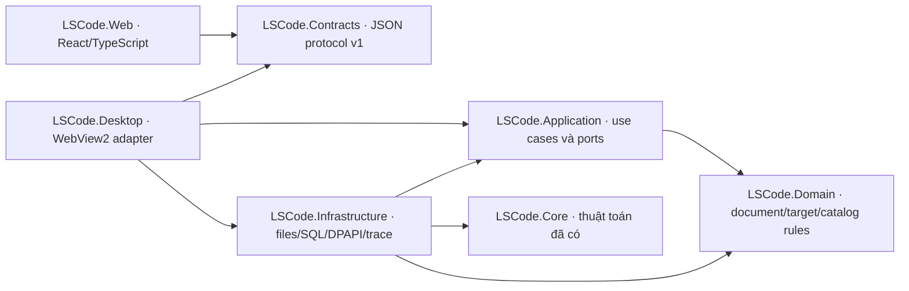

> [Cài đặt LSCode WebView trên Windows x64](CAI-DAT-LSCODE.vi.md) · [Lịch sử file và thao tác dự án](../history/WORKBENCH-PROJECT-HISTORY.vi.md)

> Cập nhật mới: [Workbench 10/11/2026](../history/WEBVIEW-UPDATE-2026-11-10.vi.md), thay thế mô tả explorer, split editor, startup và Profiler cũ.

# LSCode React + WebView2 — hướng dẫn và trạng thái chuyển đổi

Ngày 10/11/2026. Stack được chọn: React 18, TypeScript, Monaco Editor, WPF host tối thiểu, WebView2 và .NET 10.

## Chạy bản đã đóng gói

Mở `artifacts/publish-webview/LSCode.WebView.exe`. Giữ nguyên toàn bộ thư mục đi kèm, đặc biệt `wwwroot`, `Assets`, `Template`, DLL và `LSCode.TraceHost.exe`; không chỉ sao chép một file EXE. `build-webview.ps1 -Publish` tạo bản Windows x64 self-contained nên máy chạy không cần cài .NET 10 Desktop Runtime; vẫn cần Microsoft Edge WebView2 Runtime.

### Khởi động và thao tác trong trình soạn thảo

- Màn chờ xanh hiện từ cửa sổ Windows trước khi WebView2 khởi tạo. Màn chờ đóng khi giao diện đã vẽ xong màn chọn dự án. Nếu WebView2 lỗi hoặc quá 45 giây, app hiển thị lỗi để người dùng có thể đóng và mở lại. Tailwind v4 điều khiển chuyển động của màn chờ web và thanh tải, không bật Preflight. Tùy chọn giảm chuyển động được áp dụng cho các hiệu ứng tải.
- Trong **Chức năng ERP**, chọn một mục để xem các file liên quan của controller theo cây thư mục vật lý trong tab **File**. Chọn file để mở editor. Chọn file hoặc thư mục và nhấn **F2** để đổi tên.
- Khi mở **Thông tin nhân viên** (`hrPIGeneralInformation`), bấm **Tab chức năng** ở đáy khung **File**. Danh sách đọc từ `dbo.hrtabinfo` của DB hệ thống, dùng `bar` làm tên và sắp xếp theo `id`. Chọn một mục để mở cây file của controller theo `sysid`. Bấm **Thông tin chung** để quay lại cây ban đầu.
- Trong SQL nhúng của file XML, gõ `@@` để xem các biến phiên FAST kèm mô tả. Gõ tiếp tên để lọc, rồi nhấn Enter hoặc Tab để chèn. Ví dụ `@@userID`, `@@sysDatabaseName` và `@@prime$partition$current`.
- Trong **Dự án của bạn**, bấm **Đồng bộ** để lấy hồ sơ từ danh mục chuẩn. Dùng **Tạo profile** cho hồ sơ thủ công hoặc **Import XML** / **Export XML** để làm việc qua tệp. Xem [đợt chuyển sang danh mục tự chứa](../history/SELF-CONTAINED-PROJECT-CATALOG-AND-TEMPLATE-STUDIO.vi.md).
- Khi vào dự án, vùng editor bắt đầu trống. Bấm **SQL mới** khi cần viết truy vấn.
- Trong tab **DB**, gõ tên object để tìm. App đợi 280 ms sau lần gõ cuối, hoặc 500 ms khi bật **Tìm nội dung**, hủy yêu cầu cũ và giữ kết quả trước trong lúc chờ. Kết quả phân trang 200 dòng bằng `ROW_NUMBER()` và `TOP`, tương thích SQL Server không hỗ trợ `OFFSET … FETCH`. Bộ nhớ đệm tối đa 24 trang trong 30 giây. Nút **Tìm**, Enter và **Tải lại** truy vấn trực tiếp.
- Bấm **Ẩn không gian dự án** ở đầu sidebar. Bấm biểu tượng **File dự án**, **Chức năng ERP** hoặc **Database** ở thanh dọc để hiện lại vùng tương ứng.
- Kéo mép trên của panel kết quả để đổi chiều cao. Có thể Tab đến mép này rồi dùng mũi tên lên/xuống, Shift để tăng bước, hoặc Home/End để chọn chiều cao nhỏ nhất/lớn nhất.
- **SQL Profiler** mở thành tab cạnh các file. Tên đăng nhập mặc định là `profile`. Khi nhận sự kiện, lưới cuộn xuống cuối và hiện SQL của sự kiện mới nhất. Chọn hoặc cuộn đến dòng cũ sẽ tạm ngưng tự cuộn trong khi phiên thu tiếp tục. Bấm **Theo dõi cuối lưới** để theo tiếp. Kéo qua các ô rồi nhấn **Ctrl+C** để dán vùng vào Excel. Đổi tab giữ phiên thu, đóng tab sẽ dừng phiên.
- Nhấn `Ctrl+Shift+T` để mở một tab **Cấu trúc và dữ liệu** cạnh đường dẫn file. Con trỏ vào ngay ô **Bảng**. Nhấn Tab để đi qua **Cột SELECT**, **WHERE**, **ORDER BY**. Dùng mũi tên để chọn gợi ý rồi nhấn Tab để chèn và chuyển ô. Gợi ý chèn tên cột thông thường trực tiếp, dùng ngoặc vuông cho tên có ký tự đặc biệt. Nhập tên bảng để dùng schema `dbo`, hoặc nhập `schema.bảng` cho schema khác. Đổi **App/Sys** ngay trong tab để tra cùng tên bảng trên DB khác. Mỗi tab giữ kết nối riêng, và đổi DB sẽ xóa bộ lọc và kết quả của DB trước.
- Chế độ **Cấu trúc** hiển thị khóa chính, khóa ngoại và ràng buộc duy nhất. Chọn các dòng rồi nhấn chuột phải. **Gen ADD COLUMN** và **Gen ALTER COLUMN** sao chép script theo định nghĩa hiện tại của cột để bạn dán vào tab SQL, chỉnh và chạy. **DROP COLUMN** chạy lệnh trên kết nối hiện tại sau khi xác nhận. SQL Server sẽ từ chối nếu cột còn phụ thuộc vào khóa hoặc ràng buộc.
- Để tạo script phân kỳ ERP, mở bảng trên kết nối **App**. Nếu tên gốc khớp `dbo.sysgendata.basetable`, chẳng hạn `d46`, `d46$` hoặc `d46$000000`, script tác động tới bảng mẫu, bảng `$log` nếu có và gọi `FastBusiness$Partition$Execute` cho các bảng `$%Partition`. Khoảng chạy lấy từ ngày nhỏ nhất trong `dmstt.ngay_gh1` đến ngày lớn nhất trong `dmstt.ngay_gh2`. Với **ADD**, script bỏ qua các cột đã có và cập nhật `NULL` thành chuỗi rỗng cho cột kiểu ký tự cho phép `NULL`. Với **ALTER**, script đổi kiểu và khả năng nhận `NULL` của cột hiện có.
- Lưới dữ liệu đọc tối đa 200 dòng mỗi trang và giảm số dòng nếu trang chứa dữ liệu lớn. Dùng **Trang trước** và **Trang sau** để duyệt toàn bộ kết quả. Lưu các ô đang sửa trước khi chuyển trang. Khi dữ liệu dễ có giá trị trùng ở cột sắp xếp, thêm khóa duy nhất vào cuối ORDER BY để giữ thứ tự giữa các trang.
- Menu **Script** có **Script tạo bảng** và **Script INSERT dữ liệu đang hiển thị**. Script INSERT lấy tập dòng của trang đang xem và bỏ các cột do SQL Server tự sinh như computed hoặc rowversion. Cả hai mở trong tab SQL để xem hoặc sao chép.
- Mở **Tìm kiếm** ở thanh trái bằng Ctrl+Shift+F rồi nhập nội dung. Kết quả tự cập nhật, hiện mỗi tệp một lần và đưa con trỏ tới vị trí khớp đầu tiên khi bấm vào tệp. Có thể thu hẹp phạm vi theo thư mục. Tìm kiếm dùng nội dung chưa lưu của tệp đang mở.

Styles do dự án quản lý được build qua Tailwind v4. `motion.css` là điểm vào của utility và token animation. `styles.css` dùng `@apply` để giữ nguyên thứ tự selector của các component hiện có. Token theme, keyframe và các khai báo dành riêng cho WebView2 vẫn viết ở dạng CSS gốc. Preflight được tắt để tránh làm đổi bố cục Monaco và các control hiện có.

### Kiểm tra và đóng gói

Chạy `./build-webview.ps1 -Test -Smoke -Publish` để tạo bản Windows x64 self-contained chạy trực tiếp. Bài kiểm tra SQL có thể dùng SQL Server LocalDB thông qua `LSCODE_TEST_SQL_SERVER`.

Khi bản trước đang mở, dùng `-PublishDirectory artifacts/publish-webview-profiler` để xuất bản cạnh bản đang chạy.

```powershell
$env:LSCODE_TEST_SQL_SERVER = '(localdb)\MSSQLLocalDB'
dotnet run --project tests/LSCode.WebView.Tests -c Release -- --sql
```

Để tạo bộ cài Windows x64, sau khi build frontend, publish self-contained vào thư mục mới. Chạy Inno Setup với `scripts/LSCode.WebView.iss` và `/DPublishDir=<thư mục publish>`. Đặt bộ khởi động WebView2 của Microsoft ở `artifacts/installer-tools/MicrosoftEdgeWebview2Setup.exe` trước khi biên dịch bộ cài. Kết quả nằm tại `artifacts/installer/LSCode-WebView-Setup-x64.exe`.

1. Chọn dự án trong thanh ngữ cảnh, hoặc mở thư mục/file để làm việc độc lập.
2. Với dự án đã đồng bộ, mở tab SQL sẽ có các target App/SYS do .NET đọc từ cấu hình. Target được giữ riêng cho từng tab.
3. Với profile chưa có connection strings, dùng **Kết nối SQL** để chọn server/database và Windows/SQL authentication.
4. F5 chạy selection nếu có, nếu không chạy cả document. Nút Dừng hủy SqlCommand. Kết quả có nhiều result sets và xuất CSV.
5. Ctrl+Shift+P tìm mọi công cụ: danh mục, XML/XPath/include, snippets, compare, Profiler, dịch, Crystal và cài đặt.

Trong trình soạn thảo XML, khối CDATA dùng màu cú pháp SQL, còn CDATA trong `<script>` dùng màu JavaScript. Các thẻ `<sql>` và `<query>` cũng tô màu SQL trực tiếp. Với XML ERP có `<fields>` và `<views>` cùng cấp, khung **Vấn đề** báo field thiếu trong tất cả view, tên field khai báo trùng, ID view trùng và field lặp trong cùng một view. Tham chiếu `[field].Label` được tính là nhãn. Bấm cảnh báo để nhảy đến dòng liên quan.

- Kiểm tra XML và xem trước Grid/Dir đọc include theo đường dẫn của file đang mở. LSCode lần theo `DOCTYPE` và khai báo `SYSTEM`/`PUBLIC`, dò thư mục của file khai báo và các thư mục `Include/XML` của dự án. Nội dung include đang sửa trong editor được ưu tiên. Lệnh mở include cũng dùng cùng quy tắc dò đường dẫn.

- Mở file XML Grid hoặc Dir và bấm **Xem trước Grid / Dir** trên thanh editor. Bản xem trước đọc nội dung đang sửa và ưu tiên nhãn tiếng Việt. Grid lấy thứ tự cột từ view và độ rộng từ `<fields>`. Dir lấy độ rộng và vị trí các ô từ view. Mặt nạ `1` mở một ô, `0` nối cột vào ô trước và `-` chừa một cột trống. `[field].Label` hiển thị nhãn. Trường có `hidden="true"` được ẩn, vị trí các ô Dir phía sau vẫn theo mặt nạ. Khi có nhiều view, có thể chọn view để xem. Toolbar hiển thị để đối chiếu bố cục.

- Mặt nạ layout ERP nhận `1` để bắt đầu ô, `0` để nối cột và `-` để bỏ qua cột. Đặt con trỏ vào tên field để xem độ rộng. Khung **Vấn đề** so số ô dành cho field với số field sau khi loại nhãn `[field].Label` và ô dành cho nhãn. Dòng chỉ có nhãn được bỏ qua. Trong chuỗi đối số của lời gọi `f.` hoặc `g.` ở `<script>`, editor gợi ý field có trong view.
- Trong preview Dir, `[field].Description` lấy diễn giải từ `<footer>` và được bỏ qua khi đếm hoặc kiểm tra trùng field. Các ô `<items style="Grid" controller="…">` hiển thị bố cục Grid trong thư mục `Grid` cùng cấp với `Dir`. `categoryIndex` khớp với nhóm trong `<categories>` của view. `row` đặt số cột bố cục mà bảng chi tiết chiếm trong nhóm.
- Các category trong preview Dir là tab theo thứ tự khai báo trong view. Các field chưa gán category luôn hiển thị phía trên thanh tab. Nội dung phía dưới gồm field và Grid chi tiết của category đang chọn. Dùng **← / →** để chuyển tab khi thanh tab đang được chọn.
- **Dự án của bạn** xếp dự án đã mở gần nhất lên đầu. Có thể xóa profile sau khi xác nhận. Profile tạo thủ công trùng sẽ được báo lỗi. Trường **Thư mục update** mặc định là `\\172.168.5.14\CustomerUpdate\<Tên dự án>\update\` và có thể sửa trong thông tin profile.
- Nhấn **Ctrl+Shift+N** để mở cửa sổ LSCode mới và chọn dự án khác. Trong không gian dự án, cuộn ngang để đọc tên file và menu dài. Bấm **×** cạnh nhóm controller để bỏ nhóm khỏi cây File.
- Cây File làm nổi bật hàng thư mục và đường dẫn của file đang xem. Trong **Cài đặt → Giao diện & công cụ**, chỉnh riêng **Cỡ chữ Không gian dự án** (11–19 px) và **Cỡ chữ editor** (10–24 px), rồi bấm **Lưu cài đặt**.
- Trên cửa sổ đủ rộng, kéo vạch ở mép phải **Không gian dự án** để đổi chiều rộng. Có thể đưa focus vào vạch rồi dùng **← / →**. LSCode lưu độ rộng khi thả chuột hoặc chỉnh bằng bàn phím.

Trình duyệt tại `http://127.0.0.1:4173` chỉ dùng xem/kiểm tra giao diện. Không có HTTP backend hoặc kết nối SQL trong bản xem này. Mở EXE để dùng chức năng thật.

## Build và kiểm chứng

```powershell
# Frontend + .NET + kiểm tra nền + smoke WebView2 thật + publish
./build-webview.ps1 -Test -Smoke -Publish

# Thêm tích hợp SQL trên instance cục bộ . bằng Windows Authentication
./build-webview.ps1 -Test -SqlIntegration -Smoke -Publish

# Build cả solution, gồm bản WPF cũ
dotnet build LSCode.sln -c Release -m:1 -p:UseSharedCompilation=false

# Chạy riêng SQL/Profiler integration
dotnet run --project tests/LSCode.WebView.Tests/LSCode.WebView.Tests.csproj -c Release -- --sql --profiler
```

SQL integration tạo database tên ngẫu nhiên `LSCodeWebViewTest_<GUID>` trên instance kiểm thử, mặc định là `.`, sau đó xóa đúng database do chính phép thử tạo. Dùng instance cục bộ hoặc LocalDB cho phép thử này. Lựa chọn `--profiler` dùng cùng cách tự chọn bộ thu với tab Profiler. Thêm `--profiler-ssms18` để kiểm tra riêng nhánh SSMS 18 trên server tương thích.

Để chạy kiểm tra tương tác UI bằng fixture transport:

```powershell
# Chạy server preview, để tiến trình này chạy trong terminal riêng
node scripts/preview-webview.mjs

# Playwright cài riêng trong thư mục công cụ, không cần thêm vào dependencies của app
node scripts/test-webview-ui.mjs <thư-mục-có-node_modules-playwright>
```

Script kiểm tra UI dùng fake native transport được khai báo rõ trong chính script. Kết quả này kiểm chứng hành vi React/Monaco, không thay thế SQL/.NET integration.

## Kiến trúc hiện có



- **Domain** không tham chiếu WPF, WebView2, SQLClient hay filesystem.
- **Application** điều phối mở/lưu/khôi phục, chọn file/thư mục và ranh giới thực thi lệnh; phụ thuộc port, không phụ thuộc Infrastructure.
- **Infrastructure** thực hiện lưu file, snapshot/hash, search/index, catalog DPAPI, kết nối/query/schema, dịch, snippets, designer transaction và hai engine Profiler. Các thuật toán thuần đang có trong Core được tái sử dụng qua adapter, không đưa toàn bộ Core chứa IO vào Domain.
- **Desktop** là composition root và adapter Windows: WebView2, native file picker, clipboard trên STA thread, mở cửa sổ mới và đóng ứng dụng. Nội dung web chỉ tải từ asset đóng gói tại origin cố định `https://lscode.local`; navigation/frame/window lạ và quyền trình duyệt được chặn.
- **Web** gồm workbench, Monaco model registry, gateway và các màn riêng trong `src/LSCode.Web/src/features`. Connection strings/session secret giữ phía .NET; mật khẩu chỉ nằm tạm trong form và được xóa sau kết nối, không ghi localStorage/settings. Một Monaco model dùng chung cho split panes; kết quả và target gắn với tab. Caret/scroll/selection được giữ theo file và pane; đóng pane không xóa target completion. Response tìm kiếm/metadata cũ bị loại khi ngữ cảnh thay đổi.

Một số adapter thuần .NET vẫn dùng `Compile Link` tới file dịch vụ gốc ở `LSCode.Shell/Services`. Đây là tái sử dụng source có chủ ý để giữ parser, SQL batching và TraceHost đang chạy; Infrastructure **không tham chiếu assembly WPF**. Chưa xóa các dịch vụ/assembly WPF trước khi nghiệm thu thay thế.

## Bao phủ tính năng

Đối chiếu các ID với [ma trận chuyển đổi](../specifications/WEBVIEW-MIGRATION.vi.md). “Có source/UI” và “đã kiểm chứng trên dự án thật” là hai trạng thái khác nhau.

| Nhóm | Đã chuyển trong bản mới | Bằng chứng và phạm vi |
|---|---|---|
| F01–F04 | Mở nhiều file, new/save/save-as, BOM/encoding/newline, readonly override, hash conflict, recovery, hỏi lưu trước đóng | Kiểm tra file thật trong temp; smoke native mở/lưu UTF-16 BOM; không dùng file dự án để thử ghi |
| F05–F06 | Cây lazy, refresh, quick open, split cùng model/undo | UI tương tác; split trong WebView2 thật; mở nhanh có `.f`/`.ent`/ASPX |
| F07–F10 | Highlight theo ngôn ngữ/theme, find/replace, format, XML markers/Problems/outline/XPath, include peek/open | Core parser tests, native format/XML smoke, Monaco UI; JS hint chỉ trong script khi tài liệu là XML |
| F11–F12 | Search buffer chưa lưu, regex/case/cancel, command palette, shortcut mapping cũ, chỉnh 2 phím/lệnh, lối tắt và thứ tự | Core/search adapter checks và UI; search/index bỏ qua thư mục sinh tự động |
| F13–F16 | Profiles, import preview/merge/export/metadata, discovery/sync, App/SYS theo tab, cây chức năng, controller/Grid children | DPAPI import/export và target isolation đã kiểm tra; CustomerPro/menu/controller trên dự án LAN thật chưa nghiệm thu lại |
| F17–F20 | Windows/SQL auth, giữ secret phía .NET, GO/session/timeout/cancel, result sets/CSV, schema/alias/snippet completion/cache refresh | SQL cục bộ thật; giữ temp table qua GO, Cancel thật, completion đọc schema thật; UI đổi tab không đổi target cũ |
| F21–F22 | DB objects có trang/tìm tên-nội dung/script; table browser cấu trúc/dữ liệu, chọn cột/WHERE/ORDER BY, giới hạn 1000 | SQL adapters và kiểm tra read-only query; chưa chạy mọi loại object/encrypted module trên ERP thật |
| F23–F24 | Tạo bảng/add fields, PK/UNIQUE/identity/default/FK/collation, SQL preview, nhập draft, duplicate template, copy/paste fields và dòng chọn | SQL cục bộ: 4 audit fields, Unicode/NULL token, rollback batch, schema conflict, không copy dữ liệu, giữ UNIQUE/FK/scale/DEFAULT NULL, datetime2(7), rowversion |
| F25–F26 | Snippet CRUD/import/export/caret, SQL/JS hints và placeholders, text/folder compare, beautify SQL | Thuật toán/snippet fixtures đã kiểm tra; UI các công cụ mở và thao tác được |
| F27 | SQL Profiler tự chạy khi mở tab có kết nối. Lấy server và tiền tố database từ tab, ưu tiên `PROFILER.EXE` đã lưu hoặc SSMS mặc định. Có thể chọn lại executable trong Cài đặt hoặc tab Profiler. | Khi thiếu SSMS, SQL Server 2008 và kết nối có tài khoản Profiler riêng dùng SQL Trace tích hợp; SQL Server 2012 trở lên dùng Extended Events. Batch SQL Trace dùng cú pháp tương thích SQL Server 2008. SQL Trace qua SSMS vẫn cần thư viện và trace definition tương thích. |
| F28–F29 | Dịch thủ công/đổi chiều/copy/chèn/browser fallback; Crystal launcher và cấu hình executable | Adapter và tests provider hiện hữu; chưa gọi Google/Crystal thật trong lượt này |
| F30–F31 | Light/Dark/High Contrast, cửa sổ native resize/maximize, loading/error/empty, Settings/AppData/DPAPI | Build/smoke Windows và kiểm tra UI nhiều độ rộng/theme; chưa nghiệm thu cấu hình nhiều màn hình/DPI như một bài kiểm thử hệ thống riêng |
| F32 | Giữ agent contracts | Không tạo AI provider/chat giả; agent adapter vốn chưa có không được tính là đã chuyển |

## Cách làm việc với danh mục

- **Mở bảng** tải metadata và trang dữ liệu. **Bảng mới** tạo nháp với bốn trường hệ thống; chưa có thay đổi database cho tới khi Lưu.
- **Nhân bản cấu trúc** tạo nháp mới, không chép bản ghi. Kiểu/constraint không thể tái tạo đầy đủ sẽ báo lỗi, không âm thầm bỏ ràng buộc.
- **Chi tiết** của trường cho phép đặt identity seed/increment, thứ tự PK, collation, DEFAULT NULL và chọn cột khóa ngoại tương thích.
- **Sao chép cấu trúc / Dán trường** giữ metadata trong cùng phiên ứng dụng; TSV bên ngoài dùng 8 cột Name, Type, Size, Required, Key, Unique, Identity, Default.
- Ở tab Dữ liệu, chọn dòng bằng cột số thứ tự; `#` chọn toàn trang. Sao chép chỉ các cột nghiệp vụ. Dán từ chính ứng dụng giữ đúng NULL và chuỗi có dạng `:null`; TSV ngoài có thể có hàng tên cột để ánh xạ theo tên. Cột identity/computed/rowversion/audit được xử lý tự động.
- `:null`, `:default`, `:empty` là các lựa chọn khi nhập trực tiếp vào ô nháp. Chuỗi thật bắt đầu bằng `:` được escape khi copy/paste để không bị hiểu thành lệnh.
- **Xem trước** tạo token một lần; **Lưu vào database** dùng token đó, kiểm tra lại schema và thực hiện trong transaction. Không tự retry commit chưa xác định kết quả.

## Dữ liệu cũ và rollback

Settings, `projects.dat` và biến `LSCODE_DATA_HOME` giữ tương thích với thư mục LSCode hiện có. Catalog DPAPI vẫn thuộc tài khoản Windows hiện tại. WebView có `webview-recovery.json`, thư mục profile WebView2 và `webview-snippets.xml` riêng; nếu chưa có snippets mới sẽ đọc `snippets.xml` cũ hoặc asset mặc định. Như vậy sửa snippet trong hai bản không tự đồng bộ hai chiều.

Source và EXE WPF cũ được giữ. Có thể quay lại `artifacts/publish-ui-a/LSCode.exe`; tránh mở hai bản cùng sửa một file/catalog. Bản mới chỉ ghi file người dùng khi người dùng Lưu, và chỉ ghi SQL theo lệnh Run/Lưu danh mục đã chọn.

## Giới hạn và điều kiện nghiệm thu còn lại

- Chưa tuyên bố parity 100% trên BACHVIET/CustomerPro thực tế. Cần kiểm lại discovery LAN, database permissions, menu/controller đặc thù, Crystal và dịch vụ dịch trong môi trường sử dụng thật.
- SSMS 18 Trace cần trace definition tương thích với SQL Server đích. Máy kiểm thử SQL Server 16.0 cục bộ thiếu trace definition tương ứng. Bộ kiểm thử tích hợp có thể chạy Extended Events trên máy đó.
- Giới hạn vẫn rõ trên UI: editor 16 MB, XML analysis tối đa 1 triệu ký tự, 5000 hàng/result và 30 result sets cho query, table browser 1000 hàng, designer 100 hàng/trang và 1000 bản ghi mỗi lần lưu, clipboard 5 MB. Quick open/controller index giới hạn 100000 file.
- Kết quả SQL đang gửi theo từng lần thực thi có giới hạn, chưa triển khai giao thức streaming/paging kết quả qua `resultId` như hướng mở rộng trong đặc tả. Grid đã ảo hóa DOM. Recovery gửi snapshot gộp qua bridge, mỗi message tối đa 40 MB; khi vượt giới hạn ứng dụng báo lỗi, không coi là đã lưu recovery thành công.
- Monaco làm bundle lớn; worker và language assets được đóng gói offline. Build có thể cảnh báo chunk lớn, không phải lỗi typecheck/build.

## Thiết kế và bằng chứng UI

Bố cục được chọn theo yêu cầu “dựng luôn”: một vùng điều hướng File/Chức năng/DB, editor chiếm vùng chính, target cạnh nút Chạy, panel kết quả/Thông báo/Vấn đề ở dưới. Giữ flat, không thêm dashboard/KPI/chat. Vùng IDE dùng mật độ 32px cho hàng/nút phụ và editor 14px; form dùng control 40px. Ô nhập không có icon trang trí. Giữ cả Light/Dark/High Contrast vì là tính năng có sẵn.

Đổi thương hiệu ở `src/LSCode.Web/src/styles.css`: `--primary`, `--primary-hover`, `--primary-foreground` trong từng theme; font UI ở `--app-font`. Font editor ở `src/LSCode.Web/src/editor.tsx` (`fontFamily`).

Ảnh và report nằm trong `artifacts/webview-ui`: Light/Dark desktop, High Contrast 1920px, mobile 375px, native WebView2 và probe. Ảnh browser có dữ liệu **fixture giả**, được khai báo riêng trong script test, không được nhúng vào dữ liệu ứng dụng thật. Không dùng ảnh Unsplash/avatar hoặc số liệu kinh doanh bịa.

Đã soi bằng mắt: các hàng cùng loại giữ chiều cao; nút/link nhìn ra chỗ bấm; editor/results không bọc nhiều card; khoảng trống lớn là vùng soạn thảo cần giữ; hành động chính Chạy/Lưu nổi theo đúng tác vụ. Ở 375px, sidebar đóng/mở và bảng cuộn trong vùng riêng thay vì kéo ngang cả trang. Kiểm tra máy đo và ảnh không thay thế nghiệm thu thao tác Windows/DPI đầy đủ.

## Kết quả kiểm chứng của lượt triển khai

- Core hiện hữu: **137 checks passed**.
- WebView/application/SQL/Profiler cục bộ: **49 checks passed** khi chạy đủ `--sql --profiler` (bao gồm file, readonly, recovery, ERP file index, schema, token/transaction và live Extended Events).
- Native WebView2 smoke: bootstrap, bridge, formatter, XML, asset snippets, Monaco, mở/lưu BOM và split; tiến trình thoát sau kiểm tra.
- Browser interaction: **21 checks passed**; Unicode save, shared split và đóng split vẫn giữ target completion, virtual grid 5000 dòng, theme, target isolation, mở công cụ, clipboard danh mục và không tràn trang ở 375px. Report ở `artifacts/webview-ui/interaction-report.json`.
- Probe UI đã quét 1440→375px qua 55 độ rộng, không thấy điểm vỡ bố cục. Sau sửa đường kẻ tab, lượt cuối ở 375/1280/1440/1920 không đo ra lỗi; report ở `artifacts/webview-ui/probe-final/report.json`. Báo cáo full sweep trước đó vẫn giữ ở `artifacts/webview-ui/probe/report.json`.

Không dùng kết quả fixture để khẳng định đã thử các database/dịch vụ khách hàng thật.

## Danh sách dự án và tab menu ERP (15/11/2026)

- Mã dự án dùng chữ đậm và nền highlight theo màu nhấn trong **Cài đặt → Theme** (`--primary`); tên dự án nằm trong cột cố định, không dịch theo độ dài mã. Mã dài tự xuống dòng; tên/đường dẫn dài vẫn có nội dung đầy đủ qua tooltip.
- Cây **Menu chức năng** hiển thị thêm `wmenu_id` bên phải mỗi dòng; kết quả tìm kiếm cũng hiển thị mã này.
- Nhấn **F3** hoặc chuột phải trên menu để mở **Menu ERP** trong vùng tab làm việc. Cây menu vẫn cuộn và thao tác được. Chuyển tab giữ bản nháp; đóng tab, tải lại hoặc mở menu khác có xác nhận nếu chưa lưu. Ctrl+W đóng tab menu đang chọn. Tab giữ đúng kết nối/dự án lúc mở.
- **Thêm mới**: mã cây tiếp tục được sinh theo nhánh; mã command độc lập, lấy mã chưa dùng từ `AA.00.00` tới `AA.99.99`, tăng phần cuối trước, kiểm tra cả `dbo.wcommand.menu_id` và `dbo.command.menu_id`. Khi hết mã thì báo lỗi. Lúc lưu vẫn kiểm tra trùng trong transaction; mã đã tồn tại không bị ghi đè.
- Không đổi mã command của menu cũ. Hệ thống không có cột `menu_id` vẫn dùng schema hiện hữu.

### Kiểm tra rủi ro CRAP cho mã command

Phạm vi: `MenuEditor.NextCommandId` trong `src/LSCode.Infrastructure/MenuEditor.cs`. Độ phức tạp đếm thủ công là **3**: cơ sở 1 + vòng `for` 1 + `if` 1. Có kiểm tra điểm bắt đầu, lỗ trống, chuyển nhóm và hết 10.000 mã. Chưa công bố điểm CRAP: bộ kiểm thử là console runner, chưa có provider/converter Cobertura trong repository; cần báo cáo Cobertura chứa phương thức này để tính coverage thực. Kết quả test pass không thay thế coverage.

## Thanh công cụ, đóng nhóm file và SQL Debug / Watch (15/11/2026)

### Giao diện và lịch sử

- Bỏ nhãn `WebView`, `.NET Desktop` trên thanh tiêu đề.
- **Chức năng ERP** chỉ giữ ô tìm kiếm và cây menu; bỏ hai nút Tải chức năng / Đồng bộ. Nút tải lại ở góc trên sidebar vẫn nạp lại cây chức năng. Nút tải lại trong tab sửa menu là thao tác riêng, vẫn giữ để đọc lại bản ghi.
- Chuột phải vào **tên dự án cấp trên cùng** trong Lịch sử: **Close project** đóng các tab thuộc dự án đó; **Close all projects** đóng tab thuộc tất cả dự án. File được nhận diện theo dự án gắn với tab hoặc thư mục dự án gần nhất chứa file; SQL chưa lưu không thuộc dự án được giữ lại. Các thao tác này không xóa file, profile hay lịch sử.
- Bấm **×** ở nhiều file liên tiếp sẽ ẩn từng mục ngay. LSCode gom các lần xóa gần nhau theo dự án rồi ghi file lịch sử một lần; file nguồn và tab đang mở không bị xóa. Nếu lần lưu nền thất bại, danh sách được tải lại từ dữ liệu đã lưu và lỗi xuất hiện trên giao diện.
- Bản nháp được hỏi một lần cho cả nhóm: Lưu thay đổi / Đóng không lưu / Hủy. Hủy lưu hoặc lưu lỗi giữ các tab mở. Khi query editor đang chạy, dừng query trước khi đóng nhóm.

### Watch và bảng dữ liệu trong LSCode

1. Bấm **SQL Debug / Watch** ở thanh editor, chọn database.
2. Nhập **SQL ngữ cảnh**, hoặc bấm **Lấy SQL từ editor** để sao chép nội dung tab editor đang chọn.
3. Chọn **Biểu thức / biến**, ví dụ SQL ngữ cảnh `DECLARE @id int = 7;`, Watch `@id + 1` trả về `8`.
4. Chọn **Query xem dữ liệu** để nhập `SELECT TOP (100) ...`; có thể thêm nhiều Watch và chuyển giữa chúng.
5. **Chạy Watch** chỉ chạy Watch đang chọn. Mỗi lần chạy thực thi lại toàn bộ SQL ngữ cảnh và query Watch trên một kết nối mới. Không tự refresh, không tự rollback; SQL ngữ cảnh có lệnh ghi vẫn có tác dụng như chạy SQL bình thường. `GO` trong ngữ cảnh có quy tắc batch của SQL Server: biến chỉ tồn tại trong batch khai báo.
6. Các bảng kết quả hiển thị riêng, hỗ trợ quét vùng và Ctrl+C; tối đa 5.000 dòng/bảng, 30 bảng theo SQL runner. Dừng Watch hủy request đang chạy; đang chạy thì không đóng tab hoặc đóng app. Thay đổi kết nối/nội dung xóa kết quả cũ để tránh hiểu nhầm.

### Breakpoint, step và Watch biến trong stored procedure

**Debug bằng SSDT** là tích hợp mở script sang debugger T-SQL thật của **Visual Studio + SQL Server Data Tools**, không phải debugger nhúng trong Monaco. Máy hiện tại đã phát hiện được Visual Studio 2026 có SSDT.

- Nhập script gọi procedure vào SQL ngữ cảnh, chọn đúng database, bấm **Debug bằng SSDT**. App xuất file UTF-8 dưới `%LOCALAPPDATA%\LSCode\SqlDebug` (hoặc `LSCODE_DATA_HOME/SqlDebug`) rồi mở trong Visual Studio.
- Trong Visual Studio, kết nối đúng server/database qua SQL Server Object Explorer / SQL query editor rồi chọn **Execute with Debugger / Alt+F5**. Việc mở file không tự chạy SQL.
- **F9** bật/tắt breakpoint, **F10** Step Over, **F11** Step Into, **Shift+F11** Step Out; mở **Debug → Windows → Watch / Locals** để xem biến tại điểm dừng. Có thể xem các result set của script trong query editor.
- Kết nối cần quyền `sysadmin`; debug SQL Server từ xa cần cấu hình firewall/debugger. LSCode không tự thay đổi quyền hay cấu hình máy chủ. Mật khẩu kết nối không được xuất vào file hoặc tham số tiến trình; đăng nhập trong Visual Studio khi cần.
- Watch trong LSCode chạy phiên độc lập, không đọc được biến cục bộ của procedure đang dừng bên SSDT. Xem các biến đó tại Watch/Locals của SSDT. Chưa triển khai breakpoint/step trực tiếp trong editor LSCode.

Nguồn: [Microsoft — T-SQL debugger](https://learn.microsoft.com/en-us/sql/ssms/scripting/transact-sql-debugger), [Run the Transact-SQL debugger](https://learn.microsoft.com/en-us/sql/ssdt/debugger/run-transact-sql-debugger).

### Kiểm chứng

- `scripts/test-workbench-ui.mjs`: kiểm tra nhãn/nút đã bỏ, đóng nhóm với hủy/lưu/bỏ bản nháp, giữ lịch sử/tab ngoài dự án; Watch biểu thức/query, kết nối, lỗi, hủy request, nhiều bảng và handoff SSDT bằng transport giả. Chạy preview ở `127.0.0.1:4173`, sau đó `node scripts/test-workbench-ui.mjs artifacts/ui-test-tools` khi Playwright đã có.
- SQL integration trên LocalDB kiểm tra SQL ngữ cảnh, biến scalar và bảng biến cùng phạm vi thực thi. Kiểm tra script SSDT xác nhận quote database và giữ nguyên SQL gốc.
- Chưa chạy phiên breakpoint thực tế vào stored procedure ERP trên máy chủ của người dùng; cần kết nối/quyền debugger tại môi trường đó.

Kết quả kiểm tra bản này: **131 checks backend/LocalDB**, **16 checks UI**, **8 checks native WebView smoke** đều đạt; frontend build và desktop publish thành công. Kiểm tra UI dùng dữ liệu mẫu, không phải dữ liệu ERP thật. Probe bổ sung còn ghi nhận các hạn chế bố cục sẵn có: nhãn Chức năng xuống dòng ở sidebar 1280px; ở viewport 375px, nút Mở thư mục xuống dòng và vùng tìm kiếm trên header nhỏ. Các điểm này chưa được sửa trong phạm vi bổ sung Watch/đóng nhóm file.

# Toolbar editor

Generate Update và SQL Watch được mở từ thanh lối tắt hoặc bảng lệnh, không hiển thị thành nút chữ thường trực trên toolbar editor. Với tab SQL, toolbar ưu tiên co ô tìm trong file và ô chọn database; nút **Chạy** cùng các nút icon giữ nguyên kích thước khi phóng to, thu nhỏ hoặc khôi phục cửa sổ.

## Mở nhanh và phím tắt (17/11/2026)

- **Ctrl+Shift+4** mở tab **Generate Update**. ID nội bộ `advance-note` vẫn giữ để tương thích thiết lập và XML đã lưu.
- **Ctrl+Shift+P** mở bảng lệnh và đặt con trỏ ngay trong ô tìm; có thể gõ tên lệnh mà không cần nhấp chuột.
- Kéo một hoặc nhiều file từ Windows Explorer vào cửa sổ LSCode để mở. Thư mục và đường dẫn không còn tồn tại bị bỏ qua; tối đa 100 file mỗi lượt. File đã mở được đưa về tab hiện có thay vì tạo bản sao.
- Trong **Cài đặt → Phím tắt**, các lệnh được chia theo File & cửa sổ, Editor & XML, SQL & dữ liệu, Dự án, Công cụ, Giao diện & hệ thống. Ô tìm lọc theo tên, ID lệnh hoặc phím mặc định; mỗi lệnh vẫn hỗ trợ hai tổ hợp.

## Theo dõi thời gian query (17/11/2026)

Khi nhấn **F5** hoặc **Chạy**, thanh công cụ của panel Kết quả hiển thị **Đang chạy · …** và cập nhật mỗi 100 ms. Khi query kết thúc, nhãn đổi thành **Thời gian · …**; kết quả thành công dùng thời gian do SQL runner trả về, còn query lỗi hoặc bị dừng giữ thời gian đã chạy ở phía giao diện. Thời gian dưới một giây hiển thị bằng mili giây, dưới một phút bằng giây và query dài hơn hiển thị theo `phút:giây`.

## Viền cửa sổ (17/11/2026)

LSCode dùng cửa sổ không có chrome mặc định của Windows, vì vậy toàn bộ ứng dụng có viền 1 px riêng theo Light, Dark và High Contrast. Viền nằm trong kích thước cửa sổ, giúp nhận ra mép cửa sổ khi mở nhiều dự án chồng nhau mà không làm thay đổi bố cục editor.

## Cấu trúc và dữ liệu (17/11/2026)

- WHERE và ORDER BY nằm cùng hàng theo tỷ lệ 70/30; cửa sổ hẹp tự chuyển thành hai hàng. Thông báo thành công/lỗi là toast LSCode ở góc trên, không làm lưới bị đẩy xuống; xác nhận xóa dữ liệu cũng dùng modal của ứng dụng thay hộp thoại hệ thống.
- Nút **Lưu** nằm cạnh **Chạy**. Nhấn chuột phải vào ô **App/Sys** để sao chép tên database đang chọn.
- **Tập lệnh → Tạo lệnh INSERT cho kết quả hiện tại** mở script từ các dòng và cột của lần tải gần nhất, theo bộ lọc đã chạy. Các chỉnh sửa chưa lưu chưa có trong script.
- Lưới hiển thị `datetime` theo `dd/MM/yyyy HH:mm` và `smalldatetime` theo `dd/MM/yyyy`. Khi chỉnh sửa trên lưới, LSCode vẫn dùng giá trị gốc.

- Các ô trong vùng quét đều có viền. Ô đang nhập có nền xám theo theme.
- Nhập ở dòng `*` hoặc nhấp đúp để sửa ô, kể cả cột khóa cho phép ghi. **Lưu** hoặc **Ctrl+S** ghi các thay đổi cùng lúc. Khi trùng khóa, SQL Server hoàn tác lần lưu và LSCode đánh dấu dòng lỗi, khôi phục các ô khóa của dòng đó và giữ các chỉnh sửa còn lại để lưu lại.

- Màn hình dùng lưới cùng kiểu với kết quả SQL. Bấm một lần để chọn ô và dùng phím mũi tên hoặc **Tab** để di chuyển. Kéo chuột để chọn vùng hoặc bấm số dòng, tên cột hay ô `#` để chọn cả dòng, cột hay toàn bảng. **Ctrl+C** sao chép TSV. Nhấp đúp hoặc nhấn **F2** để mở ô nhập liệu. **Enter** kết thúc nhập ô và **Escape** bỏ lần sửa ô đang mở.
- Dropdown trên tab hiển thị **App** hoặc **Sys**. Nhấn **Ctrl+Alt+D** để chuyển database của tab Cấu trúc và dữ liệu đang mở.
- Menu **Tập lệnh** mở nổi ngoài toolbar nên không bị cắt khi cửa sổ hẹp. Menu có **Thêm key vào SQL Data (Ctrl+D)**, **Tạo lệnh tạo bảng** và **Tạo lệnh xóa bảng**. Các mục tạo/xóa chỉ mở script SQL để xem và tự chạy khi người dùng chủ động bấm Chạy.

### Bảng mới, định dạng INSERT và thông báo lỗi (19/11/2026)

- Sau khi tạo bảng bằng tab SQL hoặc lưu từ **Tạo danh mục → Thiết kế bảng SQL**, quay lại **Cấu trúc và dữ liệu** trên đúng kết nối App/Sys. Ô **FROM** làm mới danh sách. Chọn bảng mới để tải cột và dữ liệu trong lần mở đầu tiên. Nếu tạo bảng ở công cụ khác, gõ tên vào **FROM** để LSCode tra thêm trên SQL Server, hoặc nhấn **Tải lại danh sách bảng** để lấy lại cả danh sách.
- Chế độ **Tạo danh mục → Sinh source ERP** đọc controller mẫu từ workspace, xem trước và xuất gói file. Xem [quy trình Tạo danh mục](../specifications/CATALOG-TABLE-DESIGNER.vi.md).
- **Tập lệnh → Tạo lệnh INSERT cho kết quả hiện tại** dùng kiểu cột trong SQL Server. Ví dụ `smalldatetime` sinh `CONVERT(smalldatetime, '19/11/2026', 103)` và `datetime` sinh `CONVERT(datetime, '19/11/2026 13:07', 103)`. Kiểu 103 đọc ngày theo thứ tự ngày/tháng/năm kể cả khi phiên SQL dùng `mdy`. Khi chạy lại script, `smalldatetime` nhận giờ `00:00` và `datetime` nhận giây, phần lẻ bằng 0. `datetime2` vẫn xuất theo định dạng ISO đầy đủ.
- Lỗi thực thi SQL và lỗi tra cứu bảng xuất hiện trong thẻ thông báo nổi, có nút **Đóng thông báo**. Vị trí lưới và thanh công cụ được giữ khi thông báo xuất hiện.

## Snippet nhập nhanh trong SQL (18/11/2026)

Mở **Snippets**, tạo mẫu có **Từ khóa nhanh** bắt đầu bằng `/`, ví dụ `/1`, nhập nội dung và vị trí con trỏ rồi bấm **Lưu mẫu**. Trong tab SQL, gõ `/1`: Monaco mở danh sách snippet khớp; nhấn Enter hoặc Tab để thay từ khóa bằng nội dung. Việc gõ khóa không tự chạy SQL. Mẫu không bắt đầu bằng `/` vẫn dùng được qua màn Snippets và nút **Chèn vào editor**, nhưng không chen vào gợi ý nhanh để tránh trùng tên bảng/cột.

Các mẫu SQL cũ có khóa `ss...` nằm trong nhóm **SQL dựng sẵn** của tab Snippets thay vì xuất hiện lẫn trong gợi ý tên bảng/cột. Các biến session FAST `@@id`, `@@unit`, `@@userID`, `@@admin`, `@@language`, `@@action`, `@@master`, các biến partition và `@@sysDatabaseName` lấy từ cùng tệp snippet cho cả tab SQL lẫn SQL nhúng trong XML.

## Điều hướng nhanh Cấu trúc và dữ liệu (18/11/2026)

- **F5** chạy dữ liệu của tab Cấu trúc và dữ liệu đang chọn.
- Chọn một ô hoặc dòng rồi nhấn **Home** để tới ô đầu dòng, **End** để tới ô cuối dòng. Phím không sửa dữ liệu và vẫn giữ dòng hiện hành.
- Nhấn **Ctrl+G**, nhập hoặc chọn tên trường được gợi ý, rồi nhấn Enter hoặc **Nhận**. Lưới cuộn ngang và đặt vùng chọn vào cột đó trên dòng hiện hành.
- Nút sao chép cạnh bộ chọn App/Sys chép đúng tên database đang dùng. Toolbar của tab SQL có nút tương tự cạnh nút kết nối.

Khi chức năng ERP dùng link có thêm thư mục ảo nhưng ASPX thật nằm trong `Main`, LSCode dò theo tên file và vẫn hiển thị nhánh Main trong cây File. Thao tác chọn menu chỉ dựng cây, không tự mở file.

## Script INSERT menu ERP (17/11/2026)

Chọn menu trong **Chức năng ERP** chỉ tải cây controller vào File. Ứng dụng không tự mở file Main. Khi focus ở menu, nhấn **F12** để mở tab SQL chứa INSERT của bản ghi `dbo.wcommand` và bản ghi `dbo.command` theo `menu_id`. Có thể dùng chuột phải rồi chọn **Tạo script INSERT menu**. Nếu menu không có `menu_id` hoặc không tìm thấy dòng `command`, tab SQL ghi chú rõ trường hợp đó.

## Menu Web và Mobile (17/11/2026)

- Mở **Chức năng ERP**, chọn **Web** hoặc **Mobile** phía trên ô tìm. Web được tải nền khi mở dự án; Mobile chỉ tải lần đầu khi chọn tab.
- Web lấy `wcommand` theo quy tắc quyền/Startup hiện hữu. Mobile lấy `dbo.dvcommand`, hiển thị cây theo `wmenu_id0`, nhãn `bar` (fallback `bar2`) và dùng `sysid` để tìm controller.
- Ô tìm lọc tên, sysid và mã trên dữ liệu đã tải. Chuyển Web/Mobile giữ từ khóa và cây riêng, không truy vấn SQL theo từng ký tự.
- Nút **Tải lại** bỏ qua cache của tab đang chọn. Cache tối đa 8 ngữ cảnh và hết hạn sau 5 phút; lưu menu Web cũng xóa cache liên quan.
- Nhấp đúp hoặc bấm mã của node để dựng cây source trong File; không tự mở Main. Khi Generate Update đang chọn yêu cầu, thao tác menu tiếp tục đưa cây source vào luồng chọn file.
- F3, F12 và menu chuột phải sửa/xuất INSERT chỉ dành cho Web. Mobile chưa có trình sửa `dvcommand`; nếu dự án không có bảng này, lỗi chỉ hiện trong vùng Mobile và không ảnh hưởng cây Web.

### Check Mail

Nhấn Ctrl+Shift+P, tìm **Check Mail** rồi nhập cấu hình SMTP. Cổng mặc định là 587 với STARTTLS. Điền To và tùy chọn Cc/Bcc, ngăn cách nhiều địa chỉ bằng dấu chấm phẩy hoặc xuống dòng. Chọn Text hoặc HTML rồi bấm **Gửi thử**. Máy chủ tiếp nhận thư là kết quả của giao dịch SMTP. Đóng tab để xóa nội dung form và yêu cầu hủy thao tác đang chạy.

Trong **Dự án của bạn**, nút **Đồng bộ** bỏ qua các profile đã có mã từ danh mục chuẩn. Muốn lấy lại thông tin chuẩn cho một dự án, bấm biểu tượng đồng bộ trên dòng của dự án đó. Profile tạo tay hoặc nhập XML chưa có mã đồng bộ vẫn được đối chiếu với danh mục trong lần đồng bộ đầu.
